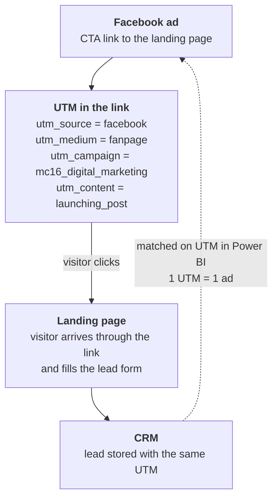

# Facebook Ads Data System: From Ads Manager Exports to a Trusted Ads Dashboard

> An end-to-end data system (**Airbyte → BigQuery → Dataform → Power BI**) that pulls Facebook Ads data every day, flattens the nested API fields, recovers each ad's landing-page link and **UTM**, and labels each ad with its course. The UTM is the key that lets ads be matched to CRM leads.

> This is the **ads side** of the company data warehouse. The **CRM side** is [crm-data-warehouse](https://github.com/tuhoang3112/crm-data-warehouse): the same BigQuery warehouse, so ads and leads can be joined.

> **Status:** ingestion → staging → data mart are built (this repo). Matching ads with CRM leads happens in the Power BI model, which is being added to this repository step by step. Demo data and the live dashboard come with it (see [Roadmap](#roadmap)).

---

## The problem

The company runs Facebook Ads as **traffic to landing pages** (not Lead Ads), and the conversion is a **form fill on the landing page**. The Pixel can report the form-fill event to Facebook, but only the CRM holds the lead itself: who it is, which course, its value and whether it was won. Leads land in the CRM with a UTM tag but no link to a specific ad.

- There was no proper dashboard. To see how ads performed, the team had to open Ads Manager, or download the data and analyse it by hand.
- Nothing connected **an ad to the leads it produced**, so "which ad creates the most leads, for which course?" had no answer.
- To judge an ad by the leads it brings, the team had to build a report by hand and count leads one by one, which took a lot of time.

**Goal:** measure how many **leads (registrations) each ad converts**. Daily, automatic ad performance, with every ad carrying its **CTA link, UTM and course**, so ads can be joined to CRM leads without manual mapping.

---

## How an ad is matched to a lead



`dim_ads` exposes `ad_utm_source / medium / campaign / content` and `ad_cta_link`. **The join itself is done in Power BI**, between `dim_ads` and the lead counts per UTM per day from the CRM. **Rule: one UTM maps to exactly one ad.** The pipeline's hard part is making the UTM columns reliable → [docs/data-quality.md](docs/data-quality.md).

---

## Architecture decisions

| Decision | Choice | Why |
|---|---|---|
| **Warehouse** | **BigQuery** | Same warehouse as the [CRM project](https://github.com/tuhoang3112/crm-data-warehouse), so both marts can be joined |
| **ETL or ELT** | **ELT** | Facebook data arrives with nested JSON (targeting, creatives, actions). It is loaded raw and flattened in SQL, so a logic fix is re-applied to all history |
| **Ingestion tool** | **Airbyte (self-hosted)**, built-in *Facebook Marketing* source | The source already has every stream needed. No custom connector (unlike the [CRM project](https://github.com/tuhoang3112/crm-data-warehouse)) |
| **Transformation** | **Dataform** | SQLX + Git, dependency graph with `ref()`, runs inside BigQuery |
| **BI** | **Power BI** | Reads the marts directly. Same BI tool as the [CRM project](https://github.com/tuhoang3112/crm-data-warehouse) |
| **Schema** | Fact + dimensions, fact at 1 row per ad per day | Matches the grain of the Facebook insights data |

---

## Sources & ingestion

| Stream | What it holds |
|---|---|
| `campaigns` | Objective, budget, status |
| `ad_sets` | Targeting, budget, promoted pixel / event |
| `ads` | Ad name, status, link to the creative |
| `ad_creatives` | Caption, CTA link, `url_tags`, `object_story_spec` |
| `ads_insights` | Daily performance per ad (spend, impressions, reach, clicks, `actions`) |

→ [ingestion/README.md](ingestion/README.md) (token permissions, API rate limits)

---

## Data model

| Table | Grain | Notes |
|---|---|---|
| `fact_ad_performance` | 1 row per ad per day | Measures only: spend, reach, impressions, frequency, clicks, link clicks, landing page views |
| `dim_ads` | 1 row per ad | CTA link, UTM, ad type, post link, **course name** |
| `dim_ad_sets` | 1 row per ad set | Effective budget (CBO / ABO) and flattened targeting |
| `dim_campaigns` | 1 row per campaign | Objective, status, account name |
| `dim_ad_course_mapping` | 1 row per mapping rule | Maps ad names to a standard course name. Maintained by hand ([why](#why-a-course-mapping-table)) |

→ [Data Dictionary](docs/data-dictionary.md) · [Metric Definitions](docs/metric-definitions.md)

### Why a course mapping table?

The course of an ad is read from the **prefix of its name**: an ad named `DI_<ad name>` belongs to the course coded `DI`. This naming rule only applies **from the beginning of 2026**. Before that, ad names were free text, so the course cannot be read from the name. `dim_ad_course_mapping` fills the gap: it maps the ads that do not follow the new rule (by exact name, by a phrase in the name, or by campaign + ad name) to a course, and it also holds the prefix → course rules for the new naming. An ad that matches no rule has no course, so a new row is added by hand.

---

## Transformation & data quality

Dataform builds **5 staging views → 5 mart tables**. The hard part is the CTA link: out of 555 creatives, 287 had no link in the official fields. A caption-regex fallback cut the creatives without UTM from 208 to 140, and only **2 ads from 2026** (the ones with real data) remained without a usable UTM.
→ [docs/data-quality.md](docs/data-quality.md) · [transform/README.md](transform/README.md)

---

## Orchestration

Runs on the same VM and the same pattern as the [CRM project](https://github.com/tuhoang3112/crm-data-warehouse): Airbyte sync → Dataform run → Power BI refresh.
→ [orchestration/README.md](orchestration/README.md)

---

## Repository structure

```text
fb-ads-lead-attribution/
├── ingestion/        # Airbyte source setup, permissions, rate limits
├── transform/        # Dataform: declarations, staging, marts
├── orchestration/    # daily schedule
└── docs/
    ├── metric-definitions.md   # metrics per campaign objective
    ├── data-dictionary.md      # column definitions
    └── data-quality.md         # CTA link / UTM recovery, coverage, known gaps
```

## Roadmap

- [ ] Add the Power BI model (in progress): ads ↔ CRM leads through UTM, lead measures
- [ ] Demo data generator (random data, same tables) so the dashboard can be shared
- [ ] Publish the Power BI dashboard (GitHub Pages, like the [CRM project](https://github.com/tuhoang3112/crm-data-warehouse))
- [ ] Lead rate and CPL per ad as Power BI measures, from CRM leads matched through UTM
- [ ] Pixel conversions (form-fill event) in the fact table, to compare with CRM leads

## Related

- [crm-data-warehouse](https://github.com/tuhoang3112/crm-data-warehouse): the CRM side. Leads come from its `fact_deal` (UTM columns).

## Data privacy

The structure and logic come from the real pipeline. In this public copy:

- The GCP project ID is a placeholder (`your-project-id`).
- Course names, ad names and campaign names in [`dim_ad_course_mapping`](transform/definitions/marts/dim_ad_course_mapping.sqlx) are **fictional**; the matching rules (prefix / exact / contains / campaign + ad) are unchanged.
- No ad account IDs, tokens, customer records or spend values are included.
