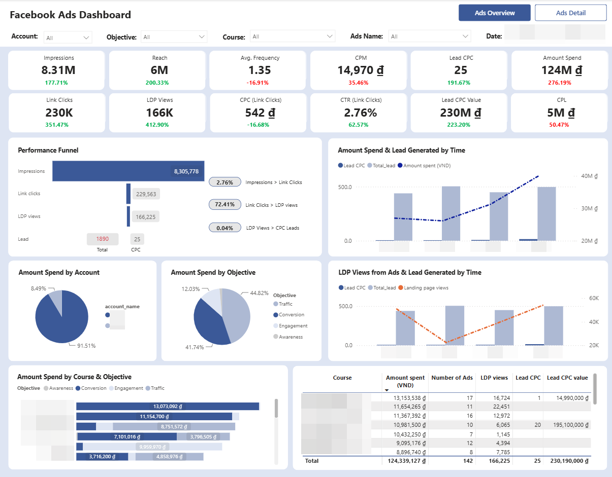
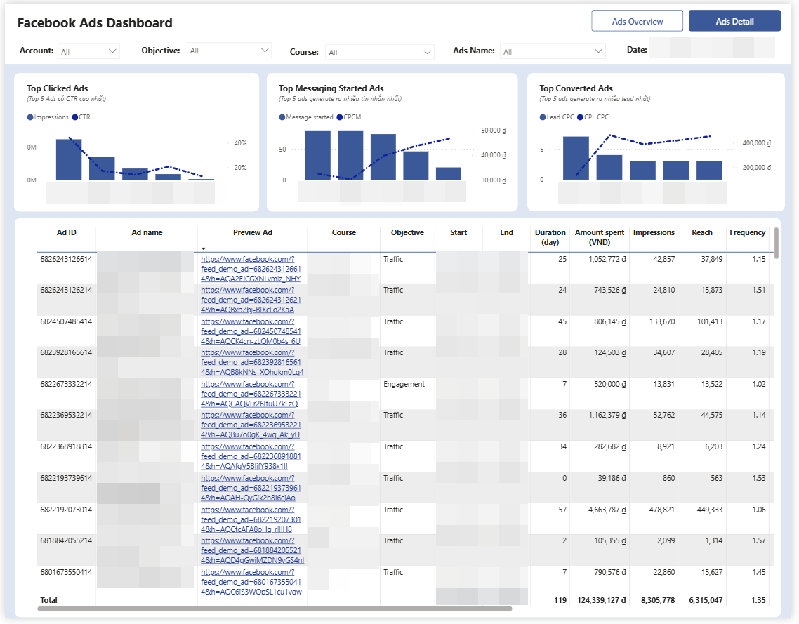
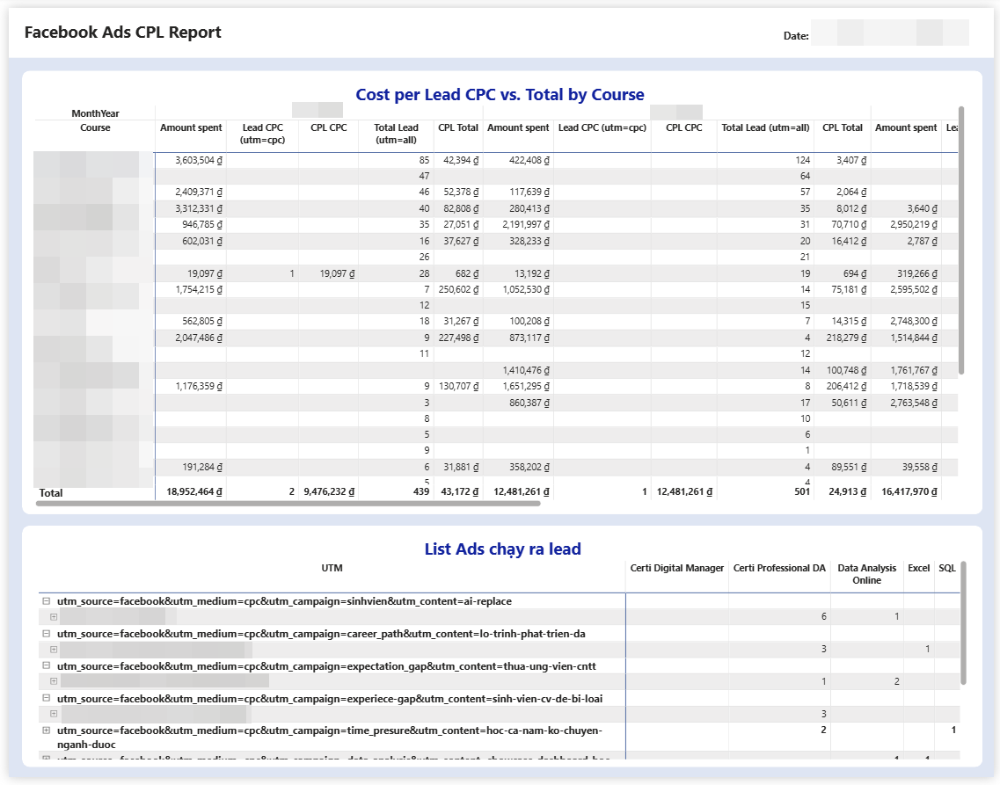
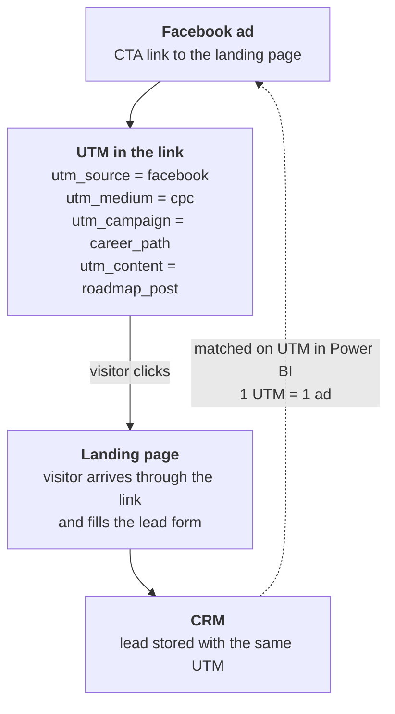
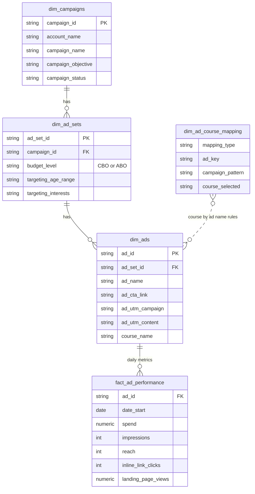

# Facebook Ads Dashboard: Which Ads Bring Leads?

> A **Power BI dashboard** that shows how Facebook Ads perform against their objective and how many **leads (registrations) each ad converts**. It reads a BigQuery **data mart** (clean tables, ready for analysis) fed daily by **Airbyte → BigQuery → Dataform**, and joins ads to CRM leads through the **UTM** in each ad's link. This is the **ads side** of the company data warehouse; the **CRM side** is [crm-data-warehouse](https://github.com/tuhoang3112/crm-data-warehouse), in the same BigQuery warehouse.

> **Status:** the data pipeline and data mart are built (this repo). The Power BI model and the dashboard are being added to this repository step by step, with demo data so they can be shared.

---

## The problem

The company runs Facebook Ads as **traffic to landing pages** (not Lead Ads), and the conversion is a **form fill on the landing page**. The lead itself (who it is, which course, its value, whether it was won) lives in the CRM, with a UTM tag but no link to a specific ad.

- There was no proper dashboard. To see how ads performed, the team had to open Ads Manager, or download the data and analyse it by hand.
- Nothing connected **an ad to the leads it produced**, so "which ad creates the most leads, for which course?" had no answer.

---

## Goal & Final Results

**Goal:** a dashboard that lets the team track ad performance along the whole funnel: awareness (reach) → click → LDP view → lead. Data refreshes automatically every day, and every ad carries its **CTA link, UTM and course**, so ads can be joined to CRM leads without manual mapping.

**Final results:** the Facebook Ads data in BigQuery is used in two ways:

- **Dashboard**: tracking ad performance every day, along the whole funnel.
- **Ad hoc analysis**: quick questions, answered straight from the data.

### 1. Dashboard

For regular monitoring of every ad. The questions it answers:

- Which ads bring the most leads, and for which course?
- What does a lead cost (CPL) by ad, course and objective?
- Where does the funnel leak: impressions → link clicks → landing page views → leads?
- Is each ad working against the objective it was set up for?

**Filters:** account, objective, course, ad name, date.

**Page 1: Ads Overview.** Performance by account, objective and course.

- 12 KPI cards, each with its change against the previous period: Impressions, Reach, Avg. Frequency, CPM, Lead, Amount Spend, Link Clicks, LDP Views, CPC, CTR (link clicks), Lead Value, CPL
- Funnel: Impressions → Link Clicks → LDP Views → Lead, with the rate between steps. The Lead step shows **total leads (all UTM)** next to **leads from ads (`utm_medium = cpc`)**
- Amount spend and leads over time, LDP views and leads over time
- Amount spend by account, by objective (Awareness, Traffic, Engagement, Conversion), and by course and objective
- Table by course: amount spent, number of ads, LDP views, leads from ads, lead value



**Page 2: Ads Detail.** Drill-down to each ad.

- Top Clicked Ads (CTR against impressions), Top Messaging Started Ads (messages started and CPCM) and Top Converted Ads (leads and CPL)
- Table per ad: ID, name, ad preview link, course, objective, start and end date, duration in days, and the metrics: Amount spent, Impressions, Reach, Frequency, CPM, Messaging started, CPCM, Link clicks, CPC, CTR, LDP views, Lead, CPL (CPC), Lead value



**Page 3: CPL Report.** Which ads produced leads, and what a lead costs.

- Cost per lead by course and month: amount spent, **leads from ads** (`utm_medium = cpc`) and their CPL, **total leads** (all UTM) and their CPL
- Ads that produced leads: UTM → ad name → number of leads by course



*Screenshots of the dashboard on data from a past period. Ad names, account names, dates and the course column are blurred.*

Each ad is read with the metrics of its own objective → [Metric Definitions](docs/metric-definitions.md).

### 2. Ad hoc analysis

For a quick question the dashboard does not answer yet, an AI agent queries the data in BigQuery, aggregates the numbers and writes the commentary.

The report is a monthly view by **portfolio, course and ad**:

- **Spend, Reach, Clicks, CTR, LDP View** come from the ads mart.
- **Lead, MQL, Won** come from the [CRM mart](https://github.com/tuhoang3112/crm-data-warehouse), matched to ads through UTM.
- **CPL** is calculated per lead, per MQL and per won.
- The commentary reads two things: **lead volume and quality** (MQL rate) and **closing ability** (Won / MQL). It uses tiers and flags small samples, so a 100% rate on 2 leads is not read as a result.

→ [analysis/sample-ad-report.md](analysis/sample-ad-report.md) (readable on GitHub) and [analysis/sample-ad-report.xlsx](analysis/sample-ad-report.xlsx) (full workbook): same structure as the real report, with **demo data (randomly generated)**.

---

## How an ad is matched to a lead



`dim_ads` exposes `ad_utm_source / medium / campaign / content` and `ad_cta_link`. **The join itself is done in Power BI**, between `dim_ads` and the lead counts per UTM per day from the CRM. **Rule: one UTM maps to exactly one ad.** The pipeline's hard part is making the UTM columns reliable → [docs/data-quality.md](docs/data-quality.md).

---

## Data model

| Table | Grain | Notes |
|---|---|---|
| `fact_ad_performance` | 1 row per ad per day | Measures only: spend, reach, impressions, frequency, clicks, link clicks, landing page views |
| `dim_ads` | 1 row per ad | CTA link, UTM, ad type, post link, **course name** |
| `dim_ad_sets` | 1 row per ad set | Effective budget (CBO / ABO) and flattened targeting |
| `dim_campaigns` | 1 row per campaign | Objective, status, account name |
| `dim_ad_course_mapping` | 1 row per mapping rule | Maps ad names to a standard course name. Needed because only ads named from 2026 carry a course prefix (`DI_...`); older names are free text. Maintained by hand ([details](#why-a-course-mapping-table)) |

Relationships in the mart (key columns only). The lead side is added in the Power BI model, through the UTM columns of `dim_ads`:



→ [Data Dictionary](docs/data-dictionary.md) · [Metric Definitions](docs/metric-definitions.md)

### Why a course mapping table?

From the beginning of 2026, the course of an ad is read from the **prefix of its name**: an ad named `DI_<ad name>` belongs to the course coded `DI`. Before that, ad names were free text, so the course cannot be read from the name. For those ads, a mapping table kept by hand in a Google Sheet pairs each course with its ad names. `dim_ad_course_mapping` brings both together.

Sample of the table (course and ad names are fictional):

| mapping_type | ad_key | campaign_pattern | course_selected |
|---|---|---|---|
| prefix | `DI` | *null* | Digital Foundation Course |
| prefix | `SQL` | *null* | SQL Basics Course |
| prefix | `MCI` | *null* | Career Interview Prep |
| exact | `ROI` | *null* | Dashboard Design Fundamentals |
| contains | `3 questions every executive` | *null* | Executive Program A |
| campaign_ad | `New Engagement Ad` | `Python - Engage - Forecast analysis - 10092024` | Python Basics Course |

---

## Behind the dashboard: the data pipeline

`Facebook Marketing API → Airbyte → BigQuery (raw) → Dataform (staging → marts) → Power BI`

Sources, architecture decisions, transformation and orchestration: [docs/data-pipeline.md](docs/data-pipeline.md)

---

## Repository structure

```text
fb-ads-lead-attribution/
├── ingestion/        # Airbyte source setup, permissions, rate limits
├── transform/        # Dataform: declarations, staging, marts
├── orchestration/    # daily schedule
├── analysis/         # ad hoc analysis: sample report (demo data)
└── docs/
    ├── metric-definitions.md   # metrics per campaign objective
    ├── data-dictionary.md      # column definitions
    ├── data-pipeline.md        # sources, architecture decisions, transformation, orchestration
    └── data-quality.md         # CTA link / UTM recovery, coverage, course mapping
```

## Related

- [crm-data-warehouse](https://github.com/tuhoang3112/crm-data-warehouse): the CRM side. Leads come from its `fact_deal` (UTM columns).

## Data privacy

The structure and logic come from the real pipeline. In this public copy:

- The GCP project ID is a placeholder (`your-project-id`).
- Course names, ad names and campaign names in [`dim_ad_course_mapping`](transform/definitions/marts/dim_ad_course_mapping.sqlx) are **fictional**; the matching rules are unchanged.
- No ad account IDs, tokens or customer records are included. The dashboard screenshots show figures from a past period, with ad names, account names, dates and the course column blurred.
