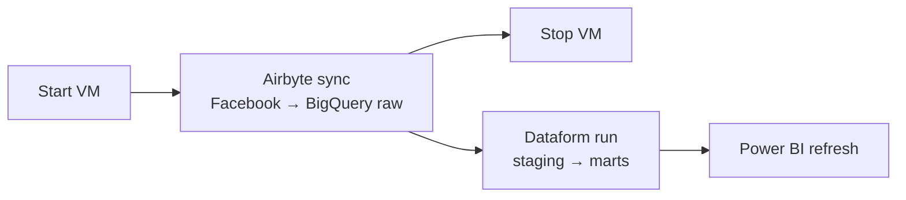

# Data Pipeline

How the data gets from Facebook into the dashboard.

`Facebook Marketing API → Airbyte → BigQuery (raw) → Dataform (staging → marts) → Power BI`

## Sources & ingestion

| Stream | What it holds |
|---|---|
| `campaigns` | Objective, budget, status |
| `ad_sets` | Targeting, budget |
| `ads` | Ad name, status, link to the creative |
| `ad_creatives` | Caption, CTA link, `url_tags`, `object_story_spec` |
| `ads_insights` | Daily performance per ad (spend, impressions, reach, clicks, `actions`) |

→ [ingestion/README.md](../ingestion/README.md) (token permissions, API rate limits)

## Architecture decisions

| Decision | Choice | Why |
|---|---|---|
| **Warehouse** | **BigQuery** | Same warehouse as the [CRM project](https://github.com/tuhoang3112/crm-data-warehouse), so both marts can be joined |
| **ETL or ELT** | **ELT** | Facebook data arrives with nested JSON (targeting, creatives, actions). It is loaded raw and flattened in SQL, so a logic fix is re-applied to all history |
| **Ingestion tool** | **Airbyte (self-hosted)**, built-in *Facebook Marketing* source | The source already has every stream needed. No custom connector (unlike the [CRM project](https://github.com/tuhoang3112/crm-data-warehouse)) |
| **Transformation** | **Dataform** | SQLX + Git, dependency graph with `ref()`, runs inside BigQuery |
| **BI** | **Power BI** | Reads the marts directly. Same BI tool as the [CRM project](https://github.com/tuhoang3112/crm-data-warehouse) |
| **Schema** | Fact + dimensions, fact at 1 row per ad per day | Matches the grain of the Facebook insights data |

## Transformation & data quality

Dataform builds **5 staging views → 6 mart tables**. The hardest part is recovering each ad's landing-page link and UTM from the Facebook creatives, because for many ads the link is only typed in the caption. After the fallbacks, only **2 ads from 2026** are left without a usable UTM.
→ [docs/data-quality.md](data-quality.md) (how the link and UTM are recovered) · [transform/README.md](../transform/README.md)

## Orchestration

Runs on the same VM and the same pattern as the [CRM project](https://github.com/tuhoang3112/crm-data-warehouse): Airbyte sync → Dataform run → Power BI refresh.
→ [orchestration/README.md](../orchestration/README.md)

