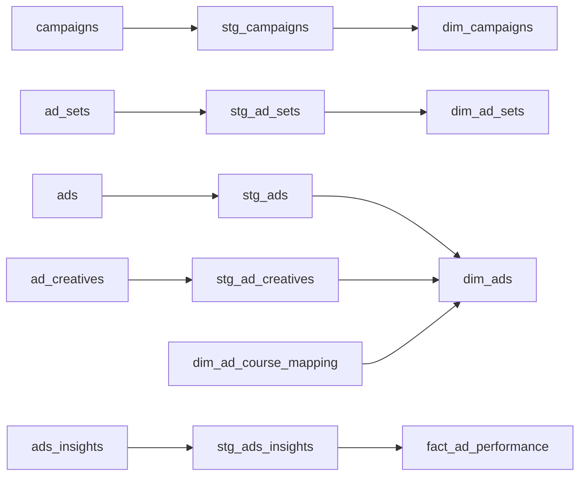

# Transform (Dataform)

Dataform builds **5 staging views → 5 mart tables** on top of the raw Airbyte tables.

The diagram shows the main path of each table. Three tables also read another staging view:

- `dim_campaigns` takes `account_name` from `stg_ads_insights`, because the campaign API does not return the account name.
- `dim_ad_sets` reads `stg_campaigns` for the budget (with a CBO campaign, the budget sits on the campaign).
- `dim_ads` takes its base list of ads from `stg_ads_insights`, because only ads with data matter.

## Staging

| Model | What it does |
|---|---|
| `stg_campaigns` | Flattens JSON labels / issues. Infers **CBO vs ABO** (the API has no such field): budget set on the campaign → CBO, otherwise ABO |
| `stg_ad_sets` | Opposite budget inference (budget on the ad set → ABO). Flattens `targeting`: the **real** age range (not `age_min` / `age_max`, which is a fixed ceiling with Advantage+), gender mapping, locations (regions + cities), placements, devices, interests, custom audiences. Lists are aggregated, never "first element only" |
| `stg_ads` | Flattens labels, bid info, targeting basics. Extracts `creative_id` to join creatives. Keeps `tracking_specs` / `conversion_specs` as JSON to avoid losing data |
| `stg_ad_creatives` | Recovers `cta_link` and UTM through fallbacks (see [data quality](../docs/data-quality.md)) |
| `stg_ads_insights` | One row per ad per day from `2026-01-01`. Casts metrics. Pulls `landing_page_views`, `view_content` and the video milestones out of the `actions` arrays |

## Marts

| Model | Notes |
|---|---|
| `fact_ad_performance` | Measures only, grain ad × day |
| `dim_ads` | Ad attributes + course. Course comes from `dim_ad_course_mapping` |
| `dim_ad_sets` | Effective budget = ad set budget, else campaign budget |
| `dim_campaigns` | Objective, status, dates, account name |
| `dim_ad_course_mapping` | Hand-maintained mapping from ad names to course names |

See the [data dictionary](../docs/data-dictionary.md).

## Course mapping

- **From 2026:** the course is read from the prefix of the ad name (`DI_<ad name>` → the course coded `DI`).
- **Before 2026:** ad names are free text, so a mapping table, kept by hand in a Google Sheet, pairs each course with its ad names.
